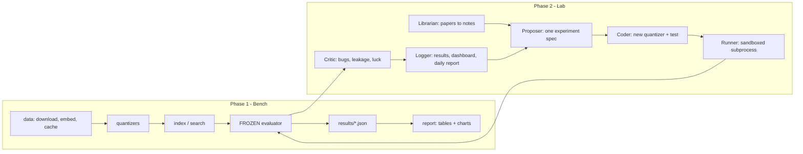

# TriVec Lab — Design

*First version, 2026-11-01. This document explains how the whole system works and
why each choice was made. It is written for a beginner: every new word is explained
the first time it appears. When the design changes, change this file.*

---

## 1. The one-paragraph version

Search engines and chatbots turn text into **embeddings**: long lists of numbers
(for example 384 numbers) where similar texts get similar lists. To find the texts
that match a question, you compare the question's list against every stored list.
Storing millions of these lists as 32-bit floats is expensive. **TriVec Lab** asks a
simple question: *how much can we shrink these lists before search quality breaks?*
It starts with the most extreme shrink that still carries sign information:
**ternary** values, where every number becomes `-1`, `0` or `+1`. The project has
two halves. The **Bench** measures recall, memory and speed honestly, against the
same baselines every time. The **Lab** is an automatic loop where an AI agent reads
papers, proposes a new compression trick, codes it, and the Bench judges it. The
Bench is the judge, and the judge is frozen so the agent cannot cheat.

---

## 2. Words you need (plain English)

| Word | Meaning here |
|---|---|
| **Vector / embedding** | A list of `d` numbers describing one text. We use `d = 384` to start. |
| **Corpus** | The pile of documents we search in. Each has one vector. |
| **Query** | A question. Also turned into a vector. |
| **Nearest neighbours (top-k)** | The `k` corpus vectors most similar to the query vector. We use `k = 10`. |
| **Dot product / cosine** | The similarity score between two vectors. Bigger = more similar. We normalise vectors to length 1, so dot product = cosine. |
| **Quantization** | Replacing precise numbers with rough ones so they take fewer bits. |
| **float32** | The original, 4 bytes per number. Our "perfect" reference. |
| **int8** | 1 byte per number (256 levels). A gentle, standard compression. |
| **binary** | 1 bit per number: just the sign (`+` or `-`). The most extreme common method. |
| **ternary** | About 1.6 bits of information per number, stored as 2 bits: `-1`, `0`, `+1`. Our main subject. The `0` means "this number was small, ignore it". |
| **PQ (product quantization)** | Splits the vector into chunks and replaces each chunk with the ID of the nearest "typical chunk" from a learned codebook. Industry standard; we use the FAISS implementation. |
| **Recall@10** | Of the 10 true nearest neighbours (found with float32), how many did the compressed search also find? 1.0 is perfect. |
| **nDCG@10** | Does the search still return documents a *human* marked relevant? Uses the dataset's relevance labels (called **qrels**). Recall@10 asks "same answer as float32?", nDCG@10 asks "good answer for the user?". We report both because they can disagree. |
| **Bytes per vector** | How much memory one compressed vector takes, including any extra numbers (like scale factors) stored alongside it. |
| **p50 / p95 latency** | Time for one query. p50 = median; p95 = the slow tail (95% of queries are faster than this). |
| **Ground truth** | The float32 exact search result on the same embeddings. Hard rule 4. |
| **Seed** | A number that fixes all randomness so a run can be repeated exactly. |
| **Provenance** | Everything you would need to re-run a result: config, seed, code version, library versions, hardware, dataset and model versions. |

---

## 3. What "ternary" actually does (worked example)

Take one vector with 8 numbers (real ones have 384):

```
x = [ 0.41, -0.02,  0.09, -0.37,  0.01,  0.22, -0.15,  0.00 ]
```

Step 1. Pick a **threshold** `t`. Numbers with `|x| < t` become `0`. We set
`t = alpha * mean(|x|)`; `alpha` is a knob (default `0.7`). Here `mean(|x|) = 0.159`,
so `t ≈ 0.11`.

Step 2. Everything else keeps only its sign:

```
code = [ +1,  0,  0, -1,  0, +1, -1,  0 ]
```

Step 3. Keep **one scale per vector** so we can roughly rebuild it:
`s = mean(|x| over the non-zero positions) = (0.41+0.37+0.22+0.15)/4 = 0.2875`.
Rebuilt vector ≈ `s * code`. That is the "decode".

Step 4. Store it **packed** as two bit-planes:

```
pos = 1 0 0 0 0 1 0 0     (where code == +1)
neg = 0 0 0 1 0 0 1 0     (where code == -1)
```

That is 2 bits per number. For `d = 384`: `2 * 384 / 8 = 96` bytes of codes, plus 4
bytes for the scale, so **100 bytes** instead of **1536** for float32. Roughly 15x
smaller. Binary would be 48 bytes; int8 would be 384 bytes. (These are storage
formulas, not measured results. Measured numbers live only in `results/`.)

Why keep the zeros at all, if binary is even smaller? The hypothesis is that
"this dimension does not matter for this document" is useful information, and that
throwing away the small values *removes noise* instead of adding it. The Bench
exists to test that hypothesis honestly. It may be wrong.

---

## 4. Two halves, three phases



| Phase | Goal | Done when |
|---|---|---|
| **0 — Skeleton** | Project builds, tests run, CI green. Quantizer interface + toy dataset. | `uv run pytest` passes in CI with one trivial quantizer. |
| **1 — Bench** | Honest numbers for ternary vs float32 / int8 / binary / PQ on 3 small public datasets. | `docs/results.md` has tables and charts generated from `results/`. Evaluator is then **frozen**. |
| **1.5 — Speed** | Packed popcount search for binary and ternary; real latency numbers. | Packed search returns the same neighbours as the slow path (tested), and timings are in results. |
| **2 — Lab** | The agent loop runs unattended, resumes after crashes, and never announces results itself. | One full cycle (paper note → proposal → code → run → critique → dashboard) works on Ollama. |

We publish after Phase 1. Phase 2 starts only when we trust the Bench
(CLAUDE.md: "do not start until the Bench is trusted").

---

## 5. Architecture and data flow (Bench)

```
configs/scifact_minilm.yaml
        │
        ▼
trivec bench ──► data/        download BEIR dataset ──► embed with sentence-transformers
                 │            ──► cache as .npy       (corpus.npy, queries.npy, ids.json, qrels.json)
                 │
                 ├──► ground truth: exact float32 top-10 for every query (cached too)
                 │
                 └──► for each quantizer × seed:
                        fit(corpus) → encode(corpus) → build index → search(queries)
                        → metrics → results/<run_id>.json   (one file per quantizer per seed)
                                                 │
trivec report ◄──────────────────────────────────┘
        │
        ▼
docs/results.md + docs/charts/*.png   (generated only, never typed)
```

**Key rule of the data flow:** the quantizer only ever sees the **corpus** when it
learns (`fit`). It never sees queries or relevance labels. Seeing them would be
**leakage**: learning from the exam before taking it.

---

## 6. Modules and interfaces

The repo layout is fixed by CLAUDE.md. Here is what lives in each module and the
small interfaces that connect them. "Interface" means: the few functions every
implementation must provide, so the rest of the system can treat them all the same.

### 6.1 `quantizers/` — one file per method

```python
# src/trivec/quantizers/base.py
class Quantizer(Protocol):
    name: str  # "ternary", "binary", "int8", "pq", "float32"

    def fit(self, corpus: FloatArray, *, seed: int) -> None:
        """Learn anything needed (thresholds, codebooks). Deterministic for a given seed.
        Sees ONLY the corpus. May be a no-op (binary needs nothing)."""

    def encode(self, x: FloatArray) -> Codes:
        """float32 [n, d] -> compressed codes. Deterministic. Codes can be any dtype/shape."""

    def decode(self, codes: Codes) -> FloatArray:
        """codes -> approximate float32 [n, d]. Used by the universal slow search."""

    def bytes_per_vector(self, dim: int) -> float:
        """Memory of ONE encoded vector, including scales / extra numbers."""
```

Every quantizer implements `decode`. That gives us a **universal correctness path**:
rebuild the approximate vectors and do an ordinary float32 search on them. Slow,
but obviously right, and it works for *any* method the Lab invents. Fast paths
(Section 6.2) are optional, and a test proves they return the same neighbours as the
slow path.

Planned files: `float32.py` (identity, the reference), `int8.py` (per-vector
min/max scaling), `binary.py` (sign), `ternary.py` (Section 3), `pq.py` (wraps
`faiss.IndexPQ`). Hard rule 8: these five are in every comparison.

**Asymmetric vs symmetric search.** *Asymmetric* means the query stays float32 and
only the corpus is compressed. *Symmetric* means both are compressed. Asymmetric
gives better recall (the query loses nothing); symmetric is what allows the
bit-trick speed-ups. We report asymmetric recall as the default "quality" number and
symmetric packed search as the "speed" number, and we always say which one a number
is. Mixing them up is the most common way these benchmarks mislead people.

### 6.2 `index/` — how search happens

```python
class FlatIndex:
    """Correctness path. Works for every quantizer."""

    def __init__(self, quantizer: Quantizer, corpus_codes: Codes) -> None: ...
    def search(self, queries: FloatArray, k: int) -> tuple[IntArray, FloatArray]:
        """asymmetric: scores = queries @ quantizer.decode(codes).T ; return top-k ids and scores"""


class PackedPopcountIndex:
    """Fast path for binary and ternary (symmetric). Codes packed into uint64 words."""

    # binary:  similarity = d - 2 * popcount(q XOR c)
    # ternary: similarity = popcount(q+ & c+) + popcount(q- & c-) - popcount(q+ & c-) - popcount(q- & c+)
```

`popcount` counts the 1-bits in a word; CPUs do it in one instruction. The ternary
formula is four popcounts per 64 dimensions, which is why ternary can be nearly as
fast as binary. v1 uses numpy's bitwise ops and `np.bitwise_count` (NumPy ≥ 2.0);
a C or Rust extension is a later optimisation only if numbers justify it.

### 6.3 `data/` — datasets, embeddings, cache

- Datasets: BEIR via Hugging Face `datasets`. Phase 1 uses three **small** ones so
  a full run finishes in minutes on a laptop: **SciFact** (~5k docs),
  **NFCorpus** (~3.6k docs), **ArguAna** (~8.7k docs). Bigger ones (FiQA, SCIDOCS,
  TREC-COVID, MS MARCO subset) come later as **held-out** sets for verification.
- Embedding model: `sentence-transformers/all-MiniLM-L6-v2` (384 dims, fast on CPU).
  Second model later: `BAAI/bge-small-en-v1.5` (also 384). Configs pin the exact
  Hugging Face **revision** (commit hash) so the model cannot silently change.
- Cache layout: `data/cache/<dataset>@<dataset_rev>/<model_slug>@<model_rev>/` holding
  `corpus.npy`, `queries.npy`, `corpus_ids.json`, `query_ids.json`, `qrels.json`,
  `ground_truth_k10.npy`. Embedding once and reusing is what makes dozens of
  experiments cheap.
- Toy dataset for tests: random Gaussian vectors with planted near-duplicates, so a
  recall sanity threshold is meaningful without downloading anything (hard rule 6).

### 6.4 `eval/` — the FROZEN evaluator

One entry point:

```python
def evaluate(spec: RunSpec) -> ResultRecord
```

It: loads cached embeddings and ground truth → fits/encodes with the quantizer
(timed = **index build time**) → runs search **one query at a time** after 20
warm-up queries to measure **p50/p95 latency** (batch size 1 is what a real
service feels) → computes **recall@10** against ground truth and **nDCG@10**
against qrels → gathers provenance → writes one JSON.

**Result JSON (hard rule 2 and 7):**

```json
{
  "run_id": "20261105T142233_scifact_ternary_s0",
  "config": { "...the full YAML that produced this run..." },
  "quantizer": "ternary", "quantizer_params": {"alpha": 0.7},
  "seed": 0,
  "dataset": {"name": "BeIR/scifact", "revision": "<hf sha>", "n_corpus": 0, "n_queries": 0},
  "model": {"name": "sentence-transformers/all-MiniLM-L6-v2", "revision": "<hf sha>", "dim": 384},
  "search_mode": "asymmetric_flat",
  "metrics": {
    "recall_at_10": 0.0, "ndcg_at_10": 0.0, "bytes_per_vector": 0.0,
    "p50_latency_ms": 0.0, "p95_latency_ms": 0.0, "index_build_s": 0.0
  },
  "provenance": {
    "git_commit": "<sha>", "git_dirty": false,
    "packages": {"numpy": "...", "faiss-cpu": "...", "sentence-transformers": "...", "torch": "..."},
    "hardware": {"platform": "...", "cpu": "...", "cpu_count": 0, "ram_gb": 0.0, "omp_num_threads": 1},
    "python": "3.11.x", "timestamp": "2026-11-05T14:22:33Z"
  },
  "status": "ok",
  "verification": "unverified"
}
```

(The zeros above are placeholders showing the schema, not results.)

**How "frozen" is enforced, not just promised:**
- `src/trivec/eval/FROZEN.sha256` lists the hash of every file in `eval/`.
- `tests/test_eval_frozen.py` recomputes the hashes and fails if any differ. CI
  runs it on every push.
- The Lab runner checks the hashes before **and after** every agent experiment.
  A mismatch marks the result `tampered` and stops the loop.
- Only you, saying "unfreeze eval", update the hash file.

nDCG@10 is implemented in ~30 lines inside `eval/` with a unit test against a
hand-worked example, and cross-checked once against the `ranx` library before the
freeze. Metrics must be right *before* they are frozen.

### 6.5 `cli.py` — three commands

```
trivec bench  --config configs/<name>.yaml      # runs every quantizer × seed in the config
trivec report [--dashboard]                     # regenerates docs/results.md, charts, and the HTML leaderboard from results/
trivec lab    run | status | approve <run_id>   # Phase 2
```

Config example:

```yaml
name: scifact_minilm
dataset: {name: BeIR/scifact, revision: <sha>}
model:   {name: sentence-transformers/all-MiniLM-L6-v2, revision: <sha>}
k: 10
seeds: [0, 1, 2]
quantizers:
  - {name: float32}
  - {name: int8}
  - {name: binary}
  - {name: pq, m: 48}            # 48 sub-vectors × 1 byte = 48 bytes/vector
  - {name: ternary, alpha: 0.7}
```

### 6.6 `results/` and `report`

- One JSON per (config, quantizer, seed). Filenames carry the `run_id`. Never
  edited by hand, never deleted; failed runs are saved too with `"status": "failed"`
  and the error (hard rule 9).
- `trivec report` reads **only** `results/` and writes `docs/results.md` (one table
  per dataset: quantizer × metrics, mean ± std over seeds) and `docs/charts/`
  (recall vs bytes/vector; latency vs recall). Every table ends with the exact
  command that reproduces it. Hard rule 3: nobody types numbers.

---

## 7. The Lab (Phase 2) — design, not yet built

### 7.1 Roles and what each one is allowed to touch

| Role | Reads | Writes | Must never |
|---|---|---|---|
| **Librarian** | arXiv API, Semantic Scholar API (topic-restricted queries) | `lab/library/notes/<paper_id>.md` (idea, method, reported numbers, link), embedded and indexed with TriVec's **own ternary index** | Download PDFs blindly or search off-topic |
| **Proposer** | Paper notes (via search), `results/`, `docs/ideas.md`, past critic reports | `lab/experiments/<id>/spec.md` — ONE experiment, with the hypothesis and the knob values | Propose two things at once |
| **Coder** | The spec, `quantizers/base.py`, one existing quantizer as an example | `lab/experiments/<id>/quantizer.py` and `test_quantizer.py` | Import or touch `trivec.eval` |
| **Runner** | The experiment folder | Runs the tests then `evaluate()` in a **sandbox subprocess**; writes `results/*.json` | Run with network, run without a timeout |
| **Critic** | Code, test output, result JSON, baselines | `lab/experiments/<id>/critique.md` with a verdict: `accept_unverified`, `reject`, `suspicious` | Mark anything "verified" |
| **Logger** | Everything above | `results/`, `reports/YYYY-MM-DD.md`, dashboard HTML | Announce a "discovery" |

### 7.2 The state machine (how it resumes after a crash)

```
lab/state.json  = { "experiment_id": "exp_0042", "stage": "coder", "started_at": "..." }
lab/experiments/exp_0042/
    spec.md  quantizer.py  test_quantizer.py  run.log  critique.md  status.json
```

Stages run in order: `librarian → proposer → coder → runner → critic → logger`.
Each stage writes its output to a temp file and renames it into place
(an **atomic write**: the file is either fully there or not at all). On start-up the
loop reads `state.json` and re-runs the stage it was in. Because every stage's
input is on disk and its output is atomic, re-running a stage is always safe.

### 7.3 The sandbox (hard rule 5)

Agent code never runs inside the main process. The Runner:

1. **Static check first.** Parse `quantizer.py` with Python's `ast`. Allow imports
   only from an allow-list (`numpy`, `math`, `typing`, `dataclasses`,
   `trivec.quantizers.base`). Reject `trivec.eval`, `importlib`, `subprocess`,
   `socket`, `os.system`, `open(..., "w")`, `exec`, `eval`. Rejection is logged as
   a result too.
2. **Run in a subprocess** with `python -I` (ignores user site-packages and the
   current directory), a **timeout** (default 20 minutes), and
   `HF_HUB_OFFLINE=1 TRANSFORMERS_OFFLINE=1 TRIVEC_SANDBOX=1`.
3. **Block the network.** The subprocess entry point replaces `socket.socket` with
   a function that raises. On Linux CI it additionally runs under `unshare -n`
   (a true no-network namespace). On Windows only the Python-level block applies;
   this is a known, documented limitation, which is why *verification* runs happen
   in CI on Linux.
4. **Hash check** of `eval/` before and after (Section 6.4).

### 7.4 The LLM plug (`lab/llm.py`)

```python
class LLM(Protocol):
    def complete(self, messages: list[Message], *, json_schema: dict | None = None,
                 max_tokens: int = 4096) -> str: ...

def get_llm(cfg: LabConfig) -> LLM:   # the ONLY place a backend is chosen
    # cfg.backend in {"ollama", "anthropic", "openai_compatible"}
```

- Default backend: **Ollama**, model set in `configs/lab.yaml` (a local coder model),
  so anyone can run the lab for free.
- Optional backends read their key from the env var named in the config
  (e.g. `api_key_env: ANTHROPIC_API_KEY`). The key itself is never in any file.
- Agent files (`proposer.py`, `coder.py`, `critic.py`) call `get_llm(cfg).complete(...)`
  and nothing else. This is the rule "never call a model directly from an agent file".
- Every prompt and reply is logged to the experiment folder, so a bad proposal can be
  traced back to what the model saw.

### 7.5 Two-level publishing

```
unverified ──(3 new seeds AND a held-out dataset pass)──► reproduced ──(you: trivec lab approve)──► verified
```

Labels live in `results/verification.json`, written only by the `approve` command.
The dashboard shows every experiment with its label. The lab never promotes
anything to `verified` on its own, and the daily report uses neutral language
("recall changed by X on SciFact, unverified"), never "we discovered".

### 7.6 Critic checklist (what "suspicious" means)

- Evaluator hash changed → `tampered`, stop everything.
- Tests failed or quantizer is non-deterministic across two runs with the same seed.
- Result better than float32 on recall@10 (impossible by definition → bug).
- Win on only one dataset, or on fewer than 3 seeds, or inside the seed-to-seed noise.
- `bytes_per_vector` does not match what the code actually stores.
- `fit()` touched anything but the corpus (checked by giving it a corpus whose
  queries are poisoned with NaN; NaN appearing in codes means leakage).

---

## 8. Decisions and why

| Decision | Chosen | Why | Rejected alternative |
|---|---|---|---|
| Language / speed | NumPy only in Phase 1 | You can read every line; correct before fast. | C/Rust extension (maybe Phase 1.5+ if popcount numbers demand it) |
| Universal `decode` on every quantizer | Required | Gives one slow-but-right search for any method, including ones the Lab invents. | Each method ships its own search (hard to verify) |
| Default quality number | Asymmetric recall | Matches how most real systems use compressed indexes; fairer to every method. | Symmetric only (favours bit methods, hides quality loss) |
| Datasets first | 3 small BEIR sets | Full run in minutes → fast public result; bigger sets kept as held-out for verification. | MS MARCO first (hours per run, slow learning loop) |
| Embedding model | MiniLM-L6-v2, 384 dims | Fast on CPU, widely known, so numbers are comparable to others. | bge-base 768 (2x slower; add as second model later) |
| Ground truth | Exact float32 search on same embeddings, cached | Hard rule 4; also cheap at these sizes. | Qrels as ground truth (that is nDCG's job, not recall's) |
| Latency measurement | Single-query loop, 20 warm-ups, p50/p95 | Reflects a real service; batched QPS also stored as a secondary number. | Batched only (hides Python overhead) |
| Freeze mechanism | Hash file + CI test + runner check | Enforced, not promised. | Just a rule in CLAUDE.md |
| Result granularity | One JSON per quantizer per seed | Easy to append, diff, and regenerate reports from; failed runs fit naturally. | One big JSON per config (gets corrupted, hard to merge) |
| Report generation | `trivec report` reads only `results/` | Hard rule 3. Makes "where did this number come from?" always answerable. | Hand-maintained tables |
| LLM default | Ollama | Free, local, no key → anyone can run the lab. | Claude API default (costs money, excludes people) |
| Sandbox | `ast` allow-list + `python -I` subprocess + timeout + socket block (+ `unshare -n` on Linux) | Layers: the cheap static check catches most, the subprocess contains the rest. | Docker only (heavy on Windows; keep as optional later) |
| Verification labels | Separate `verification.json`, changed only by `approve` | Agent cannot touch it; your manual approval is a real gate. | Field inside each result JSON (agent writes those) |
| Metric library | Own ~30-line nDCG + test, cross-checked once with `ranx` | No fragile dependency inside the frozen module. | `pytrec_eval` (C build issues on Windows) |

---

## 9. Things that can fool us, and the guard for each

| Trap | Guard |
|---|---|
| Fast path returns different neighbours than slow path | Test asserts identical top-k on the toy dataset for every packed index |
| Lucky seed | Minimum 3 seeds; report mean ± std; Critic rejects wins inside the noise |
| Single-dataset win | Verification requires a held-out dataset the Proposer never saw results for |
| Leakage (fit sees queries) | `fit()` signature only accepts the corpus; NaN-poison test in Critic |
| Timing noise | Fixed thread count (`OMP_NUM_THREADS=1` recorded), warm-up, p50/p95 not mean, hardware in every JSON |
| Model or dataset silently updates | Revisions pinned in config and recorded in results |
| Evaluator edited | Hash file + CI + runner check |
| "Too good to be true" | CLAUDE.md rule: try to break it before reporting; Critic has explicit impossible-value checks |
| Bytes/vector under-reported | `bytes_per_vector()` must include scales/codebooks; a test compares it to the real `nbytes` of the stored codes |

---

## 10. Windows notes (you develop on Windows 11)

- `uv`, `faiss-cpu` (wheels), `sentence-transformers` and `numpy` all install fine.
- Set `OMP_NUM_THREADS=1` for latency runs; the evaluator records the value.
- The strong network sandbox (`unshare -n`) is Linux-only. Local Windows runs are
  for development; **verification** runs happen in GitHub Actions on Linux.
- Paths: always `pathlib.Path`, never string concatenation.

---

## 11. Milestones (what we build, in order)

1. **Skeleton**: `git init`, `pyproject.toml` (uv), ruff, mypy strict, pytest,
   GitHub Actions, `Quantizer` protocol, `float32` quantizer, toy dataset, first
   test. *(setup code)*
2. **Ternary + binary + int8 quantizers** with the four required tests each. *(core — you write part)*
3. **FlatIndex + metrics** (recall@10, nDCG@10 with hand-worked test). *(core)*
4. **Data module**: download SciFact, embed, cache, ground truth. *(setup-ish)*
5. **Evaluator + result JSON + `trivec bench`**: first real numbers on SciFact. *(core)*
6. **PQ baseline** via FAISS; add NFCorpus and ArguAna; 3 seeds. *(core-light)*
7. **`trivec report`**: tables + charts → `docs/results.md`. **Publish v0.1.** *(setup)*
8. **Freeze eval** (hash file + test). Phase 1 ends.
9. **PackedPopcountIndex** + equality test + latency numbers. *(core)*
10. **Lab**: llm plug → state machine → sandbox runner → critic → librarian → dashboard.

---

## 12. Decisions to confirm (I made these for you; say "change X" to override)

1. **Datasets**: SciFact, NFCorpus, ArguAna first. OK?
2. **Model**: `all-MiniLM-L6-v2` (384 dims) first, `bge-small` second. OK?
3. **Ternary v1 definition**: per-vector threshold `alpha * mean|x|`, per-vector
   scale, `alpha = 0.7` default. Per-dimension thresholds and learned rotations are
   ideas for later (see `ideas.md`). OK?
4. **Asymmetric recall as the headline quality number**, symmetric packed as the
   speed number, always labelled. OK?
5. **NumPy only** until the first results are public. OK?
6. **Ollama model for the Lab**: a local coder model you can run; we pick the exact
   one when Phase 2 starts based on your machine's RAM. OK?
7. **Repo**: this folder is not yet a git repo. Hard rule 2 needs a git commit in
   every result, so the skeleton task will start with `git init`. OK?
