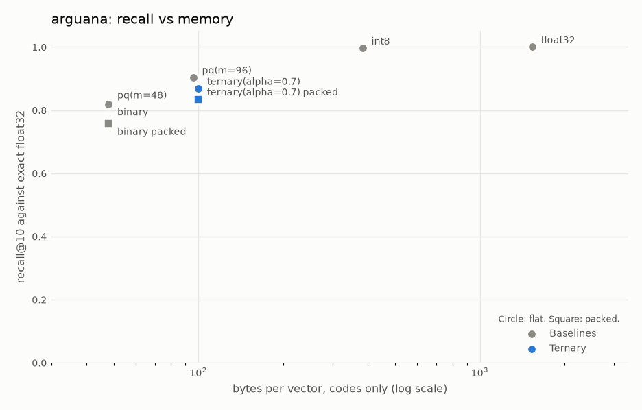
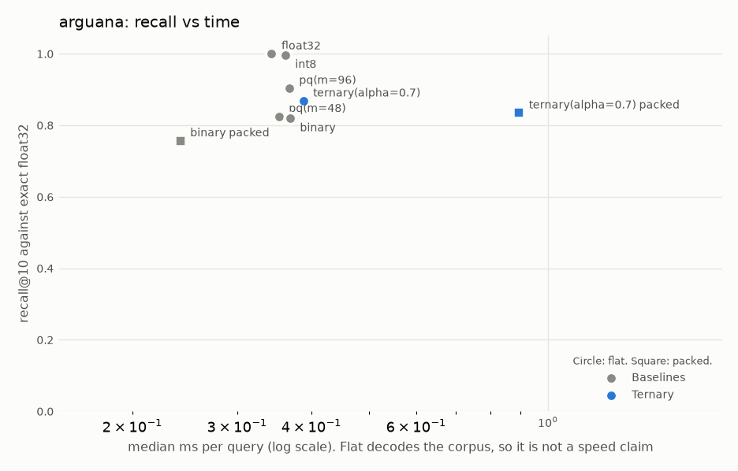
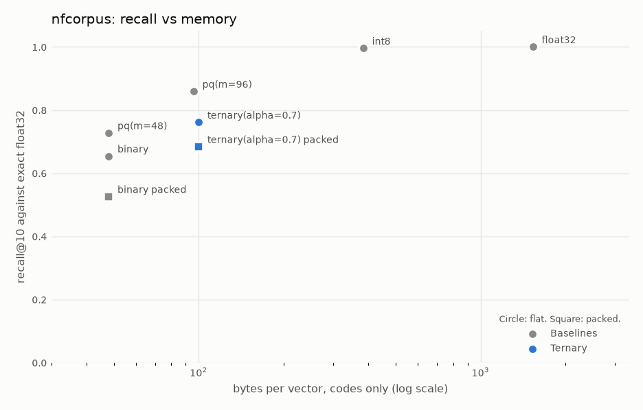
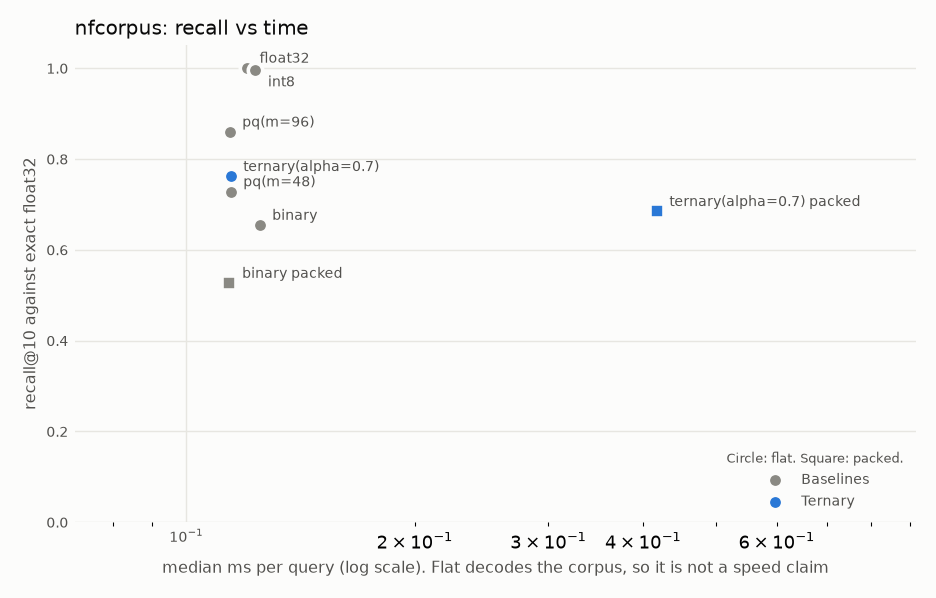
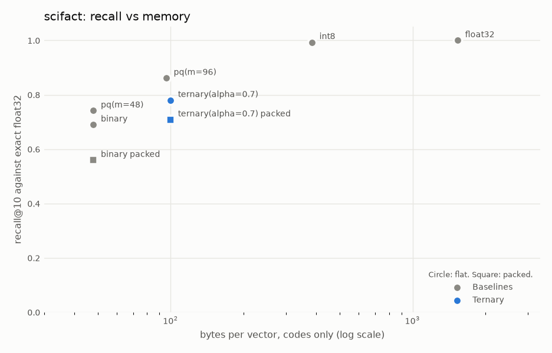
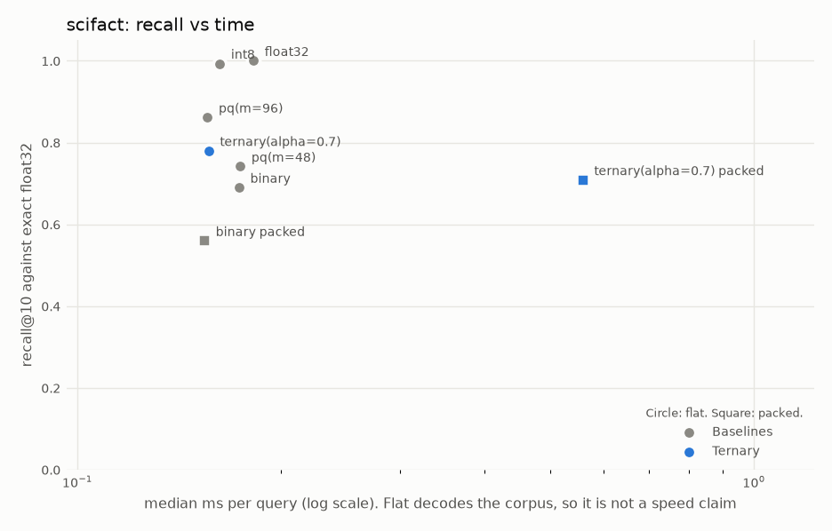

# Results

**Generated by `uv run trivec report` from `results/*.json`. Do not edit numbers by hand (hard rule 3).**

Runs: 102 ok, 0 failed. Every number is a mean over seeds, with ± population std when seeds differ. Only PQ and timings vary by seed: binary, int8 and ternary use no randomness, so their quality has no ±. See Claims tested for real uncertainty over queries.

recall@k is agreement with exact float32 search on the same embeddings; nDCG@k uses the dataset's human relevance labels.
`asymmetric_flat` keeps the query in float32 and decodes the corpus (quality reference). `symmetric_packed` compresses both sides and searches with popcount (speed path).

**bytes/vector** counts the stored codes. **with shared state** adds codebooks and scales divided by the corpus size, which is large for PQ on a small corpus and shrinks as the corpus grows.

Timings come from one busy laptop running other programs: compare them within a table, do not quote them as absolute.

## Claims tested

These claims were written in `configs/claims.yaml` and committed before the benchmark ran. Each number is the mean per-query difference (A minus B) with a 95% paired bootstrap interval over queries. `supported` means the whole interval clears the bar. This is evidence on these datasets and this one embedding model, not a general proof.

### C1: Ternary finds more of the true neighbours than binary (it costs about twice the memory).

A = `ternary(alpha=0.7)` (asymmetric_flat), B = `binary` (asymmetric_flat), metric = recall. Bar: A must beat B. **Overall: supported on every dataset.**

| dataset | A minus B | 95% interval | verdict |
|---|---|---|---|
| arguana | +0.0496 | [+0.0440, +0.0553] | supported |
| nfcorpus | +0.1074 | [+0.0926, +0.1223] | supported |
| scifact | +0.0900 | [+0.0757, +0.1053] | supported |

### C2: Ternary gives better answers for users than binary, by human labels.

A = `ternary(alpha=0.7)` (asymmetric_flat), B = `binary` (asymmetric_flat), metric = ndcg. Bar: A must beat B. **Overall: mixed: not supported on every dataset.**

| dataset | A minus B | 95% interval | verdict |
|---|---|---|---|
| arguana | +0.0181 | [+0.0069, +0.0290] | supported |
| nfcorpus | +0.0075 | [-0.0014, +0.0168] | inconclusive |
| scifact | +0.0205 | [+0.0015, +0.0395] | supported |

### C3: At about equal memory (100 vs 96 bytes), ternary beats PQ on recall.

A = `ternary(alpha=0.7)` (asymmetric_flat), B = `pq(m=96)` (asymmetric_flat), metric = recall. Bar: A must beat B. **Overall: contradicted on every dataset.**

| dataset | A minus B | 95% interval | verdict |
|---|---|---|---|
| arguana | -0.0356 | [-0.0401, -0.0312] | contradicted |
| nfcorpus | -0.0979 | [-0.1100, -0.0863] | contradicted |
| scifact | -0.0817 | [-0.0923, -0.0701] | contradicted |

### C4: At about equal memory (100 vs 96 bytes), ternary beats PQ on answer quality.

A = `ternary(alpha=0.7)` (asymmetric_flat), B = `pq(m=96)` (asymmetric_flat), metric = ndcg. Bar: A must beat B. **Overall: mixed: not supported on every dataset.**

| dataset | A minus B | 95% interval | verdict |
|---|---|---|---|
| arguana | -0.0062 | [-0.0146, +0.0017] | inconclusive |
| nfcorpus | -0.0100 | [-0.0171, -0.0029] | contradicted |
| scifact | -0.0030 | [-0.0191, +0.0125] | inconclusive |

### C5: In fast packed search, where the query is compressed too, ternary still beats binary on recall.

A = `ternary(alpha=0.7)` (symmetric_packed), B = `binary` (symmetric_packed), metric = recall. Bar: A must beat B. **Overall: supported on every dataset.**

| dataset | A minus B | 95% interval | verdict |
|---|---|---|---|
| arguana | +0.0780 | [+0.0717, +0.0846] | supported |
| nfcorpus | +0.1582 | [+0.1405, +0.1755] | supported |
| scifact | +0.1490 | [+0.1310, +0.1680] | supported |

### C6: Ternary loses at most 0.02 nDCG against uncompressed float32.

A = `ternary(alpha=0.7)` (asymmetric_flat), B = `float32` (asymmetric_flat), metric = ndcg. Bar: A may be at most 0.02 worse than B. **Overall: mixed: not supported on every dataset.**

| dataset | A minus B | 95% interval | verdict |
|---|---|---|---|
| arguana | -0.0139 | [-0.0217, -0.0060] | inconclusive |
| nfcorpus | -0.0142 | [-0.0206, -0.0076] | inconclusive |
| scifact | -0.0018 | [-0.0195, +0.0148] | supported |

### C7: Control: int8 beats ternary on recall. It has about 4x the memory, so if this fails the bench is broken.

A = `int8` (asymmetric_flat), B = `ternary(alpha=0.7)` (asymmetric_flat), metric = recall. Bar: A must beat B. **Overall: supported on every dataset.**

| dataset | A minus B | 95% interval | verdict |
|---|---|---|---|
| arguana | +0.1277 | [+0.1228, +0.1329] | supported |
| nfcorpus | +0.2344 | [+0.2192, +0.2492] | supported |
| scifact | +0.2133 | [+0.1993, +0.2263] | supported |

## Choosing alpha

Recall@10 of ternary (asymmetric_flat) by alpha. Alpha is selected on `scifact` only, so the other datasets stay a fair test of that choice. Selected: **ternary(alpha=0.7)**.

| alpha | arguana | nfcorpus | scifact |
|---|---|---|---|
| ternary(alpha=0.0) | 0.8065 | 0.6437 | 0.6843 |
| ternary(alpha=0.3) | 0.8509 | 0.7127 | 0.7423 |
| ternary(alpha=0.5) | 0.8664 | 0.7430 | 0.7660 |
| ternary(alpha=0.7) | 0.8683 | 0.7613 | 0.7800 |
| ternary(alpha=1.0) | 0.8634 | 0.7526 | 0.7697 |
| ternary(alpha=1.3) | 0.8314 | 0.7015 | 0.7293 |

## arguana · sentence-transformers/all-MiniLM-L6-v2 · k = 10

Corpus: 8674 docs, 1406 queries. Dataset revision `cfdf79adce27`, model revision `1110a243fdf4`. Machine: AMD Ryzen 5 5600H with Radeon Graphics (12 threads, OMP_NUM_THREADS=1).

| method | mode | seeds | recall@10 | nDCG@10 | bytes/vector | with shared state | p50 ms | p95 ms | build s |
|---|---|---|---|---|---|---|---|---|---|
| float32 | asymmetric_flat | 3 | 1.0000 | 0.5023 | 1536 | 1536.0 | 0.34 ± 0.00 | 0.47 ± 0.03 | 0.00 ± 0.00 |
| int8 | asymmetric_flat | 3 | 0.9960 | 0.5032 | 384 | 384.2 | 0.36 ± 0.00 | 0.50 ± 0.02 | 0.03 ± 0.00 |
| ternary(alpha=0.0) | asymmetric_flat | 1 | 0.8065 | 0.4662 | 100 | 100.0 | 0.35 | 0.46 | 0.07 |
| ternary(alpha=0.0) | symmetric_packed | 1 | 0.7471 | 0.4381 | 100 | 100.0 | 0.88 | 0.97 | 0.06 |
| ternary(alpha=0.3) | asymmetric_flat | 1 | 0.8509 | 0.4836 | 100 | 100.0 | 0.38 | 0.51 | 0.08 |
| ternary(alpha=0.3) | symmetric_packed | 1 | 0.8111 | 0.4710 | 100 | 100.0 | 0.88 | 0.92 | 0.05 |
| ternary(alpha=0.5) | asymmetric_flat | 1 | 0.8664 | 0.4893 | 100 | 100.0 | 0.35 | 0.49 | 0.07 |
| ternary(alpha=0.5) | symmetric_packed | 1 | 0.8317 | 0.4773 | 100 | 100.0 | 0.88 | 1.20 | 0.05 |
| ternary(alpha=0.7) | asymmetric_flat | 3 | 0.8683 | 0.4884 | 100 | 100.0 | 0.39 ± 0.02 | 0.81 ± 0.37 | 0.08 ± 0.00 |
| ternary(alpha=0.7) | symmetric_packed | 3 | 0.8348 | 0.4825 | 100 | 100.0 | 0.89 ± 0.01 | 0.99 ± 0.05 | 0.05 ± 0.00 |
| ternary(alpha=1.0) | asymmetric_flat | 1 | 0.8634 | 0.4921 | 100 | 100.0 | 0.37 | 0.68 | 0.07 |
| ternary(alpha=1.0) | symmetric_packed | 1 | 0.8168 | 0.4701 | 100 | 100.0 | 0.87 | 0.92 | 0.05 |
| ternary(alpha=1.3) | asymmetric_flat | 1 | 0.8314 | 0.4857 | 100 | 100.0 | 0.35 | 0.47 | 0.07 |
| ternary(alpha=1.3) | symmetric_packed | 1 | 0.7723 | 0.4596 | 100 | 100.0 | 0.88 | 0.95 | 0.05 |
| pq(m=96) | asymmetric_flat | 3 | 0.9039 ± 0.0008 | 0.4946 ± 0.0030 | 96 | 141.3 | 0.37 ± 0.01 | 0.52 ± 0.03 | 17.96 ± 0.16 |
| binary | asymmetric_flat | 3 | 0.8187 | 0.4704 | 48 | 48.0 | 0.37 ± 0.01 | 0.55 ± 0.04 | 0.01 ± 0.00 |
| binary | symmetric_packed | 3 | 0.7568 | 0.4420 | 48 | 48.0 | 0.24 ± 0.00 | 0.32 ± 0.08 | 0.00 ± 0.00 |
| pq(m=48) | asymmetric_flat | 3 | 0.8250 ± 0.0009 | 0.4594 ± 0.0032 | 48 | 93.3 | 0.35 ± 0.01 | 0.54 ± 0.05 | 8.95 ± 0.10 |

Reproduce: `uv run trivec bench --config configs/arguana_alpha_sweep.yaml && uv run trivec bench --config configs/arguana_minilm.yaml && uv run trivec report`

run ids

- `20261101T070628_arguana_float32_flat_s0`
- `20261101T070630_arguana_float32_flat_s1`
- `20261101T070631_arguana_float32_flat_s2`
- `20261101T070632_arguana_int8_flat_s0`
- `20261101T070633_arguana_int8_flat_s1`
- `20261101T070634_arguana_int8_flat_s2`
- `20261101T070635_arguana_binary_flat_s0`
- `20261101T070636_arguana_binary_flat_s1`
- `20261101T070637_arguana_binary_flat_s2`
- `20261101T070638_arguana_binary_packed_s0`
- `20261101T070639_arguana_binary_packed_s1`
- `20261101T070640_arguana_binary_packed_s2`
- `20261101T070641_arguana_pq-m48_flat_s0`
- `20261101T070651_arguana_pq-m48_flat_s1`
- `20261101T070701_arguana_pq-m48_flat_s2`
- `20261101T070711_arguana_pq-m96_flat_s0`
- `20261101T070730_arguana_pq-m96_flat_s1`
- `20261101T070749_arguana_pq-m96_flat_s2`
- `20261101T070808_arguana_ternary-alpha0.7_flat_s0`
- `20261101T070810_arguana_ternary-alpha0.7_flat_s1`
- `20261101T070811_arguana_ternary-alpha0.7_flat_s2`
- `20261101T070812_arguana_ternary-alpha0.7_packed_s0`
- `20261101T070816_arguana_ternary-alpha0.7_packed_s1`
- `20261101T070820_arguana_ternary-alpha0.7_packed_s2`
- `20261101T070835_arguana_ternary-alpha0.0_flat_s0`
- `20261101T070837_arguana_ternary-alpha0.0_packed_s0`
- `20261101T070841_arguana_ternary-alpha0.3_flat_s0`
- `20261101T070842_arguana_ternary-alpha0.3_packed_s0`
- `20261101T070845_arguana_ternary-alpha0.5_flat_s0`
- `20261101T070847_arguana_ternary-alpha0.5_packed_s0`
- `20261101T070850_arguana_ternary-alpha1.0_flat_s0`
- `20261101T070851_arguana_ternary-alpha1.0_packed_s0`
- `20261101T070855_arguana_ternary-alpha1.3_flat_s0`
- `20261101T070856_arguana_ternary-alpha1.3_packed_s0`

## nfcorpus · sentence-transformers/all-MiniLM-L6-v2 · k = 10

Corpus: 3633 docs, 323 queries. Dataset revision `efe5be03f8c5`, model revision `1110a243fdf4`. Machine: AMD Ryzen 5 5600H with Radeon Graphics (12 threads, OMP_NUM_THREADS=1).

| method | mode | seeds | recall@10 | nDCG@10 | bytes/vector | with shared state | p50 ms | p95 ms | build s |
|---|---|---|---|---|---|---|---|---|---|
| float32 | asymmetric_flat | 3 | 1.0000 | 0.3160 | 1536 | 1536.0 | 0.12 ± 0.00 | 0.18 ± 0.03 | 0.00 ± 0.00 |
| int8 | asymmetric_flat | 3 | 0.9957 | 0.3152 | 384 | 384.4 | 0.12 ± 0.00 | 0.15 ± 0.01 | 0.01 ± 0.00 |
| ternary(alpha=0.0) | asymmetric_flat | 1 | 0.6437 | 0.2941 | 100 | 100.0 | 0.11 | 0.12 | 0.03 |
| ternary(alpha=0.0) | symmetric_packed | 1 | 0.5180 | 0.2736 | 100 | 100.0 | 0.42 | 0.43 | 0.02 |
| ternary(alpha=0.3) | asymmetric_flat | 1 | 0.7127 | 0.3011 | 100 | 100.0 | 0.12 | 0.14 | 0.03 |
| ternary(alpha=0.3) | symmetric_packed | 1 | 0.6167 | 0.2877 | 100 | 100.0 | 0.41 | 0.46 | 0.02 |
| ternary(alpha=0.5) | asymmetric_flat | 1 | 0.7430 | 0.3004 | 100 | 100.0 | 0.11 | 0.12 | 0.03 |
| ternary(alpha=0.5) | symmetric_packed | 1 | 0.6659 | 0.2915 | 100 | 100.0 | 0.41 | 0.74 | 0.02 |
| ternary(alpha=0.7) | asymmetric_flat | 3 | 0.7613 | 0.3018 | 100 | 100.0 | 0.11 ± 0.00 | 0.13 ± 0.01 | 0.03 ± 0.00 |
| ternary(alpha=0.7) | symmetric_packed | 3 | 0.6842 | 0.2919 | 100 | 100.0 | 0.42 ± 0.00 | 0.44 ± 0.01 | 0.02 ± 0.00 |
| ternary(alpha=1.0) | asymmetric_flat | 1 | 0.7526 | 0.3000 | 100 | 100.0 | 0.11 | 0.13 | 0.03 |
| ternary(alpha=1.0) | symmetric_packed | 1 | 0.6591 | 0.2843 | 100 | 100.0 | 0.42 | 0.44 | 0.02 |
| ternary(alpha=1.3) | asymmetric_flat | 1 | 0.7015 | 0.2955 | 100 | 100.0 | 0.12 | 0.13 | 0.03 |
| ternary(alpha=1.3) | symmetric_packed | 1 | 0.5944 | 0.2851 | 100 | 100.0 | 0.42 | 0.46 | 0.02 |
| pq(m=96) | asymmetric_flat | 3 | 0.8592 ± 0.0012 | 0.3118 ± 0.0010 | 96 | 204.2 | 0.11 ± 0.00 | 0.12 ± 0.01 | 6.70 ± 0.09 |
| binary | asymmetric_flat | 3 | 0.6539 | 0.2943 | 48 | 48.0 | 0.12 ± 0.01 | 0.14 ± 0.01 | 0.01 ± 0.00 |
| binary | symmetric_packed | 3 | 0.5260 | 0.2756 | 48 | 48.0 | 0.11 ± 0.00 | 0.13 ± 0.01 | 0.00 ± 0.00 |
| pq(m=48) | asymmetric_flat | 3 | 0.7278 ± 0.0053 | 0.3025 ± 0.0044 | 48 | 156.2 | 0.11 ± 0.00 | 0.14 ± 0.02 | 3.05 ± 0.12 |

Reproduce: `uv run trivec bench --config configs/nfcorpus_alpha_sweep.yaml && uv run trivec bench --config configs/nfcorpus_minilm.yaml && uv run trivec report`

run ids

- `20261101T070552_nfcorpus_float32_flat_s0`
- `20261101T070553_nfcorpus_float32_flat_s1`
- `20261101T070553_nfcorpus_float32_flat_s2`
- `20261101T070553_nfcorpus_int8_flat_s0`
- `20261101T070553_nfcorpus_int8_flat_s1`
- `20261101T070553_nfcorpus_int8_flat_s2`
- `20261101T070554_nfcorpus_binary_flat_s0`
- `20261101T070554_nfcorpus_binary_flat_s1`
- `20261101T070554_nfcorpus_binary_flat_s2`
- `20261101T070554_nfcorpus_binary_packed_s0`
- `20261101T070554_nfcorpus_binary_packed_s1`
- `20261101T070555_nfcorpus_binary_packed_s2`
- `20261101T070555_nfcorpus_pq-m48_flat_s0`
- `20261101T070558_nfcorpus_pq-m48_flat_s1`
- `20261101T070601_nfcorpus_pq-m48_flat_s2`
- `20261101T070604_nfcorpus_pq-m96_flat_s0`
- `20261101T070611_nfcorpus_pq-m96_flat_s1`
- `20261101T070618_nfcorpus_pq-m96_flat_s2`
- `20261101T070625_nfcorpus_ternary-alpha0.7_flat_s0`
- `20261101T070625_nfcorpus_ternary-alpha0.7_flat_s1`
- `20261101T070625_nfcorpus_ternary-alpha0.7_flat_s2`
- `20261101T070626_nfcorpus_ternary-alpha0.7_packed_s0`
- `20261101T070626_nfcorpus_ternary-alpha0.7_packed_s1`
- `20261101T070627_nfcorpus_ternary-alpha0.7_packed_s2`
- `20261101T070830_nfcorpus_ternary-alpha0.0_flat_s0`
- `20261101T070831_nfcorpus_ternary-alpha0.0_packed_s0`
- `20261101T070831_nfcorpus_ternary-alpha0.3_flat_s0`
- `20261101T070832_nfcorpus_ternary-alpha0.3_packed_s0`
- `20261101T070832_nfcorpus_ternary-alpha0.5_flat_s0`
- `20261101T070832_nfcorpus_ternary-alpha0.5_packed_s0`
- `20261101T070833_nfcorpus_ternary-alpha1.0_flat_s0`
- `20261101T070833_nfcorpus_ternary-alpha1.0_packed_s0`
- `20261101T070834_nfcorpus_ternary-alpha1.3_flat_s0`
- `20261101T070834_nfcorpus_ternary-alpha1.3_packed_s0`

## scifact · sentence-transformers/all-MiniLM-L6-v2 · k = 10

Corpus: 5183 docs, 300 queries. Dataset revision `536e14446a0b`, model revision `1110a243fdf4`. Machine: AMD Ryzen 5 5600H with Radeon Graphics (12 threads, OMP_NUM_THREADS=1).

| method | mode | seeds | recall@10 | nDCG@10 | bytes/vector | with shared state | p50 ms | p95 ms | build s |
|---|---|---|---|---|---|---|---|---|---|
| float32 | asymmetric_flat | 3 | 1.0000 | 0.6451 | 1536 | 1536.0 | 0.18 ± 0.01 | 0.26 ± 0.04 | 0.00 ± 0.00 |
| int8 | asymmetric_flat | 3 | 0.9933 | 0.6463 | 384 | 384.3 | 0.16 ± 0.00 | 0.19 ± 0.01 | 0.02 ± 0.00 |
| ternary(alpha=0.0) | asymmetric_flat | 1 | 0.6843 | 0.6183 | 100 | 100.0 | 0.15 | 0.17 | 0.05 |
| ternary(alpha=0.0) | symmetric_packed | 1 | 0.5567 | 0.5750 | 100 | 100.0 | 0.56 | 0.62 | 0.03 |
| ternary(alpha=0.3) | asymmetric_flat | 1 | 0.7423 | 0.6321 | 100 | 100.0 | 0.16 | 0.18 | 0.04 |
| ternary(alpha=0.3) | symmetric_packed | 1 | 0.6543 | 0.6038 | 100 | 100.0 | 0.56 | 0.60 | 0.03 |
| ternary(alpha=0.5) | asymmetric_flat | 1 | 0.7660 | 0.6387 | 100 | 100.0 | 0.16 | 0.18 | 0.04 |
| ternary(alpha=0.5) | symmetric_packed | 1 | 0.6907 | 0.6167 | 100 | 100.0 | 0.56 | 0.75 | 0.03 |
| ternary(alpha=0.7) | asymmetric_flat | 3 | 0.7800 | 0.6433 | 100 | 100.0 | 0.16 ± 0.00 | 0.17 ± 0.00 | 0.04 ± 0.00 |
| ternary(alpha=0.7) | symmetric_packed | 3 | 0.7087 | 0.6337 | 100 | 100.0 | 0.56 ± 0.01 | 0.59 ± 0.02 | 0.03 ± 0.00 |
| ternary(alpha=1.0) | asymmetric_flat | 1 | 0.7697 | 0.6477 | 100 | 100.0 | 0.16 | 0.20 | 0.04 |
| ternary(alpha=1.0) | symmetric_packed | 1 | 0.6967 | 0.6399 | 100 | 100.0 | 0.57 | 0.61 | 0.03 |
| ternary(alpha=1.3) | asymmetric_flat | 1 | 0.7293 | 0.6286 | 100 | 100.0 | 0.16 | 0.18 | 0.04 |
| ternary(alpha=1.3) | symmetric_packed | 1 | 0.6337 | 0.6069 | 100 | 100.0 | 0.56 | 0.58 | 0.03 |
| pq(m=96) | asymmetric_flat | 3 | 0.8617 ± 0.0050 | 0.6463 ± 0.0023 | 96 | 171.9 | 0.16 ± 0.00 | 0.20 ± 0.03 | 10.50 ± 0.04 |
| binary | asymmetric_flat | 3 | 0.6900 | 0.6228 | 48 | 48.0 | 0.17 ± 0.02 | 0.22 ± 0.07 | 0.01 ± 0.00 |
| binary | symmetric_packed | 3 | 0.5597 | 0.5846 | 48 | 48.0 | 0.15 ± 0.00 | 0.23 ± 0.07 | 0.00 ± 0.00 |
| pq(m=48) | asymmetric_flat | 3 | 0.7416 ± 0.0029 | 0.6188 ± 0.0064 | 48 | 123.9 | 0.17 ± 0.02 | 0.23 ± 0.05 | 5.17 ± 0.13 |

Reproduce: `uv run trivec bench --config configs/scifact_alpha_sweep.yaml && uv run trivec bench --config configs/scifact_minilm.yaml && uv run trivec report`

run ids

- `20261101T070457_scifact_float32_flat_s0`
- `20261101T070457_scifact_float32_flat_s1`
- `20261101T070458_scifact_binary_flat_s0`
- `20261101T070458_scifact_float32_flat_s2`
- `20261101T070458_scifact_int8_flat_s0`
- `20261101T070458_scifact_int8_flat_s1`
- `20261101T070458_scifact_int8_flat_s2`
- `20261101T070459_scifact_binary_flat_s1`
- `20261101T070459_scifact_binary_flat_s2`
- `20261101T070459_scifact_binary_packed_s0`
- `20261101T070459_scifact_binary_packed_s1`
- `20261101T070500_scifact_binary_packed_s2`
- `20261101T070500_scifact_pq-m48_flat_s0`
- `20261101T070506_scifact_pq-m48_flat_s1`
- `20261101T070511_scifact_pq-m48_flat_s2`
- `20261101T070516_scifact_pq-m96_flat_s0`
- `20261101T070527_scifact_pq-m96_flat_s1`
- `20261101T070537_scifact_pq-m96_flat_s2`
- `20261101T070548_scifact_ternary-alpha0.7_flat_s0`
- `20261101T070549_scifact_ternary-alpha0.7_flat_s1`
- `20261101T070549_scifact_ternary-alpha0.7_flat_s2`
- `20261101T070549_scifact_ternary-alpha0.7_packed_s0`
- `20261101T070550_scifact_ternary-alpha0.7_packed_s1`
- `20261101T070550_scifact_ternary-alpha0.7_packed_s2`
- `20261101T070825_scifact_ternary-alpha0.0_flat_s0`
- `20261101T070825_scifact_ternary-alpha0.0_packed_s0`
- `20261101T070826_scifact_ternary-alpha0.3_flat_s0`
- `20261101T070826_scifact_ternary-alpha0.3_packed_s0`
- `20261101T070827_scifact_ternary-alpha0.5_flat_s0`
- `20261101T070827_scifact_ternary-alpha0.5_packed_s0`
- `20261101T070828_scifact_ternary-alpha1.0_flat_s0`
- `20261101T070828_scifact_ternary-alpha1.0_packed_s0`
- `20261101T070829_scifact_ternary-alpha1.3_flat_s0`
- `20261101T070829_scifact_ternary-alpha1.3_packed_s0`

